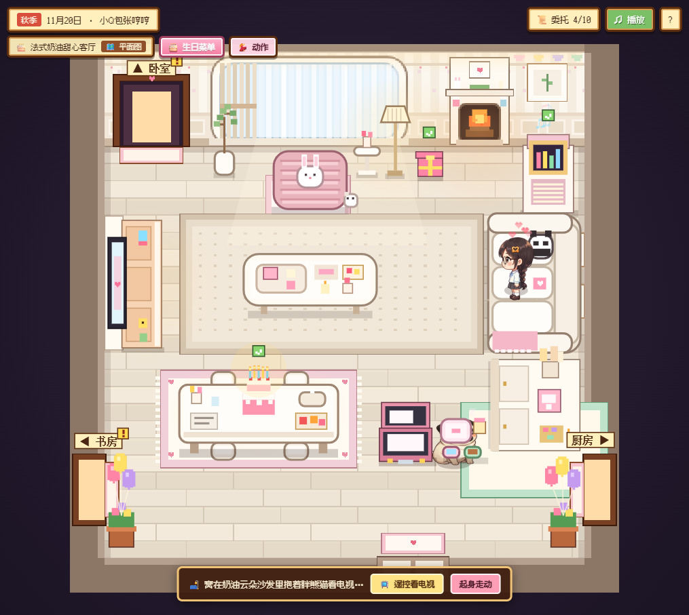
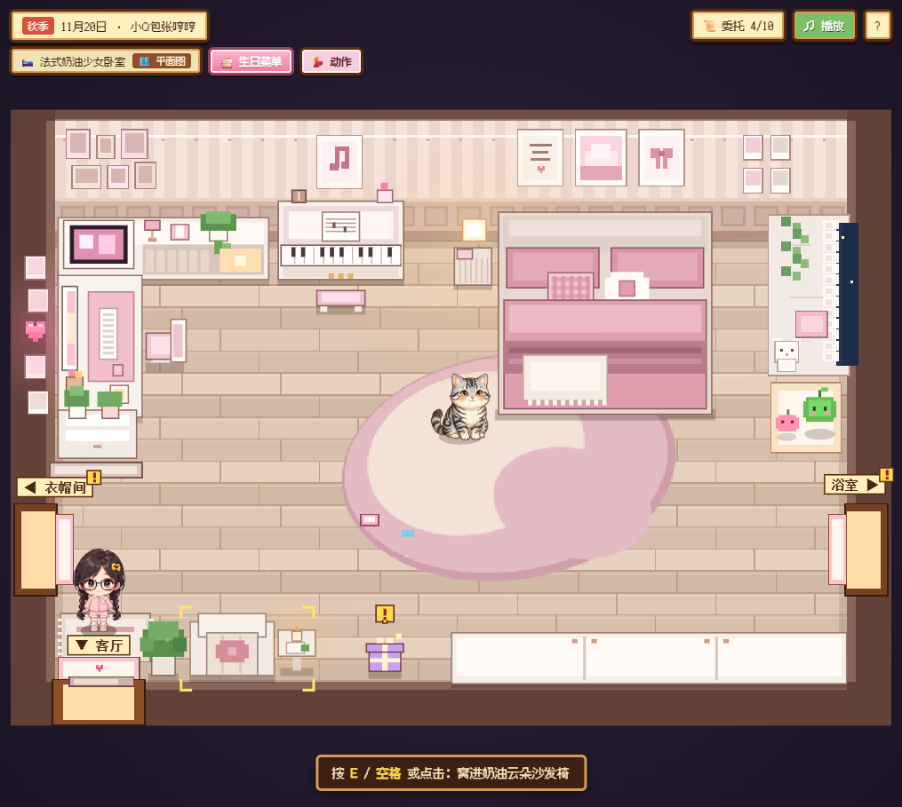
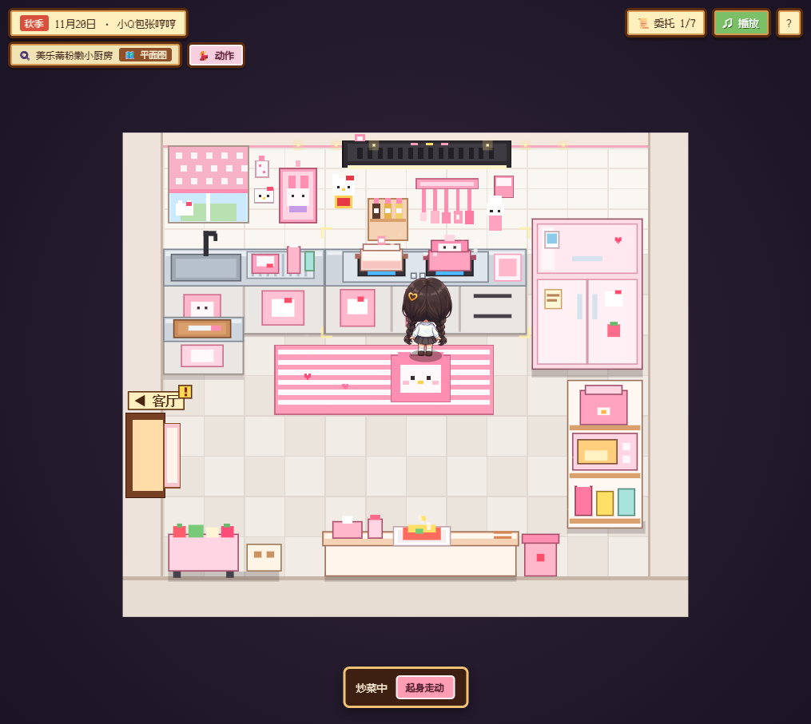
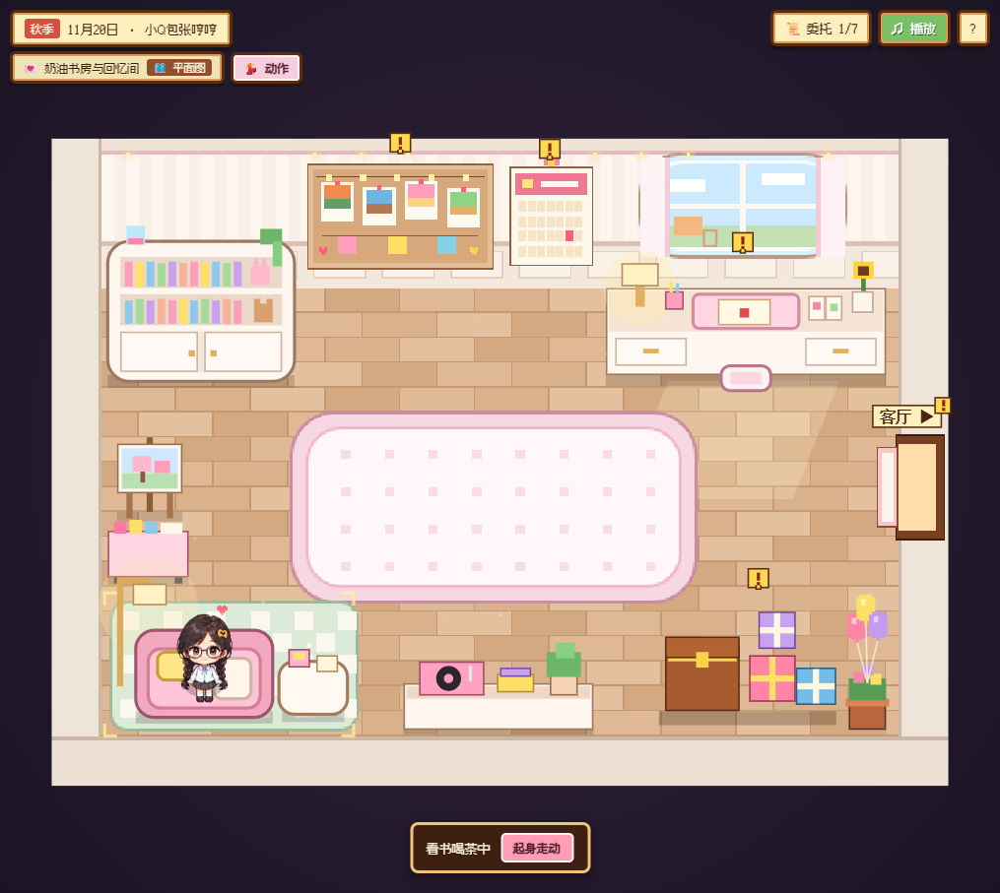

# 🎂 星露谷像素风 · 甜美六室生日惊喜小屋

一个**零构建、开箱即用、电脑与手机双端自适应**的星露谷像素风交互式生日礼物网页应用！  
你可以把它直接部署到 **GitHub Pages**，把链接发给想祝贺生日的人，让 TA 在六间温馨的甜美小房间里自由走动、撸猫逗狗、换装打扮、弹钢琴、炒菜做饭、寻找藏在每个角落的 6 份生日礼物，最后点亮满屋烟花与祝福！

---

## ✨ 房间布局与实景截图

整套小屋由 **6 间墙壁分隔、木门互通的独立房间** 组成，也可以点击左上角 **「🗺️ 平面图」** 一键串门，或点击 **「🎂 生日菜单」** 直达生日来信、照片回忆墙、礼物收集册与许愿蛋糕。

### 1. 🎂 法式奶油甜心客厅（`living`）
- 拱形白纱落地窗、粉色毛毛虫椅、悬浮电视墙、大椭圆茶几与奶油云朵沙发（可坐下抱熊猫看电视）、法式壁炉、复古点唱机、中央生日蛋糕桌。
- 客厅里住着会自己散步、打盹和跑来蹭腿的小八哥 **「团团」**。



### 2. 🛏️ 法式奶油少女卧室（`bedroom`）
- 粉色公主双人床（可盖被子睡觉 `Zzz`）、**可真实弹奏的奶油立式钢琴**、带 RGB 透明机箱的电脑桌（可打开模拟桌面小游戏）、飘窗祝尼魔与三门大衣柜。
- 卧室里住着会在猫爬架旁呼噜噜撒娇的美短猫 **「lucky」**。



### 3. 💄 甜心化妆衣帽间（`dressing`）—— 自由换装换发型
- 支持 **5 套风格服装 × 5 种发型 × 5 种发色 × 7 种发饰 × 妆容与眼镜** 自由搭配，换好后**正面、侧面、背面、睡觉姿势**都会实时生效！


### 4. 🍳 美乐蒂粉嫩小厨房（`kitchen`）—— 炒菜做饭系统
- 贴满贴纸的双门冰箱、粉色波点窗洗菜池（洗菜可获 `+12` 美味度加成）、双灶台与美乐蒂锅具、电饭煲焖饭、出餐台。
- 内置 **12 种食材 + 8 道私房菜谱 + 自由创意小炒**，支持 **小火/中火/大火控火 + 空格颠勺翻炒 + 黄金时机撒调料**，炒好的热菜会直接端上出餐台冒热气！



### 5. 💌 奶油书房与回忆间（`study`） & 6. 🛁 草莓泡泡浴室（`bathroom`）
- **书房**：法式拱门书架、灯串拍立得照片墙、粉嫩生日日历、火漆生日来信、水彩画架、樱花粉软垫阅读沙发、黑胶唱片机与丝带礼物宝箱。
- **浴室**：智能马桶、发光洗漱镜柜、干湿分离花洒淋浴间与草莓泡泡浴缸（可泡澡发呆）。
- **全屋 10 项生日委托 & 6 份隐藏礼物**：6 间房每间都藏有一份可拆封的生日礼物，集齐全部 10 项委托将触发盛大的星露谷烟花结局！



---

## 🚀 小白 1 分钟启动教程

本项目**不需要安装 webpack/vite/npm 依赖**，任选以下最顺手的一种方式即可运行：

### 方法一：用 VS Code（最推荐，零命令行）
1. 下载并解压本项目文件夹（或 `git clone` 到本地）。
2. 用 **VS Code** 打开项目文件夹。
3. 在左侧扩展商店搜索并安装 **`Live Server`** 插件。
4. 右键点击根目录的 `index.html` → 选择 **`Open with Live Server`**，浏览器会自动打开即可游玩！

### 方法二：使用 Node.js（支持手机同局域网扫码/访问）
1. 确保电脑已安装 [Node.js](https://nodejs.org/)（16 及以上版本均可）。
2. 在项目文件夹空白处右键 → 打开终端（PowerShell / 终端），输入：
   ```bash
   node server.mjs
   ```
3. 电脑浏览器打开：`http://127.0.0.1:4173/`
4. **手机一起玩**：终端里还会提示局域网地址（例如 `http://192.168.x.x:4173/`），手机连同一个 Wi-Fi，用手机浏览器打开这个地址即可（已自带虚拟摇杆与点触寻路）。

### 方法三：使用 Python（电脑自带 Python 时）
在项目根目录终端运行：
```bash
python -m http.server 4173
```
然后浏览器访问 `http://127.0.0.1:4173/` 即可。

> ⚠️ **注意**：请不要直接双击 `index.html`（`file://` 协议会被浏览器拦截部分资源加载），用以上任意一种本地服务方式打开即可完美运行。

---

## 🌐 如何免费部署到 GitHub Pages（生成网址发给别人）

部署后你会得到一个公开链接（如 `https://你的用户名.github.io/birthday_GAME/`），对方在微信、手机或电脑浏览器点开就能玩！

1. 在 GitHub 上新建一个仓库（或 Fork 本仓库），把项目全部文件上传/推送到 `main` 分支。
2. 进入仓库页面，点击顶部 **`Settings`** → 左侧菜单点击 **`Pages`**。
3. 在 **Build and deployment** 下：
   - **Source** 选择 `Deploy from a branch`
   - **Branch** 选择 `main`，目录选择 `/ (root)`，点击 **`Save`**。
4. 等待 1~2 分钟刷新页面，上方会出现你的专属访问网址，直接复制发给寿星就好啦！

---

## 🎨 小白定制指南（换人物 / 换宠物 / 改文案 / 换各种细节）

项目的文案、图片、宠物、音乐都做了清晰拆分，**不需要懂复杂编程**，按下面对应位置修改或替换图片就行：

### 1. 改寿星名字、日期、生日信、礼物、照片墙文字
全部集中在 **`js/config.js`** 一个文件里，用记事本或 VS Code 打开就能改：
- **改名字和生日**：
  ```js
  celebrantName: '小Q包张哼哼', // 改成寿星的名字
  senderName: '一直惦记你的人', // 改成你的署名
  birthdayDate: '2026-11-20',  // 改成寿星生日（YYYY-MM-DD）
  ```
- **改欢迎语 & 生日长信**：修改 `welcome` 和 `letter.paragraphs` 数组里的每一段文字。
- **改 6 份隐藏礼物内容**：修改 `gifts` 数组里每个礼物的 `name`（名字）、`tagline`（副标题）、`message`（拆开后的祝福语）。
- **把照片墙换成你们的真实照片**：
  1. 把照片放进 `assets/memories/` 文件夹（比如 `photo1.jpg`、`photo2.jpg`）。
  2. 在 `js/config.js` 的 `memories` 数组里，把对应项的 `image: ''` 改成 `image: 'assets/memories/photo1.jpg'`，同时修改 `title` 和 `caption` 即可！

### 2. 如何换人物（换主角形象 / 换衣服发型）
- **基础小人图片**在 `assets/` 目录下：
  - `assets/protagonist.png`（正面）
  - `assets/protagonist-side.png`（朝左侧面，向右走时会自动水平镜像）
  - `assets/protagonist-back.png`（背面）
  - `assets/protagonist-sleep.png`（闭眼睡觉/泡澡表情）
  - `assets/protagonist-portrait.png`（左下角对话框头像）
- **衣帽间分层换装素材**在 `assets/wardrobe/` 目录下：
  - 每个单品按 `部位_名称_视角.png` 命名（例如 `outfit_strawberry_princess_front.png`、`hair_twintails_side.png`），**替换成同尺寸的透明背景 PNG** 即可直接换掉对应衣服或发型。
  - 换装菜单的文字、预设套装与配色定义在 **`js/wardrobe.js`**，可以按需增减或改名。

### 3. 如何换宠物（换狗狗 / 猫咪 / 改名字和活动范围）
- **宠物图片**在 `assets/pets/` 目录下：
  - 狗狗：`assets/pets/pug.png`（小人形象）、`assets/pets/pug-portrait.png`（对话头像）
  - 猫咪：`assets/pets/shorthair.png`（小人形象）、`assets/pets/shorthair-portrait.png`（对话头像）
  - **直接用相同文件名的透明背景 PNG 覆盖**，就能把团团或 lucky 换成柯基、萨摩耶、布偶猫或任何你喜欢的宠物！
- **修改宠物名字、所在房间、大小和台词**：打开 **`js/pets.js`**：
  - `name` / `label`：修改宠物显示名称
  - `roomId`：修改宠物待在哪个房间（可选 `'living'`、`'bedroom'`、`'dressing'`、`'bathroom'`、`'study'`、`'kitchen'`）
  - `scale`：调整宠物在画面中的大小（如 `0.255`）
  - `bounds`：调整宠物自主散步的矩形范围 `{ minX, maxX, minY, maxY }`
  - 在 **`js/config.js`** 的 `petDialogues` 中修改互动台词。

### 4. 如何换背景音乐 & 菜谱
- **换默认背景音乐**：把你喜欢的 `.mp3` 音乐重命名为 `birthday-bgm.mp3`，直接覆盖放进 `assets/audio/birthday-bgm.mp3` 即可（点唱机里还自带程序合成的八音盒版《生日快乐歌》和《鹈鹕镇暖炉晚风》）。
- **加新菜谱 / 改食材**：打开 **`js/cooking.js`**，在 `INGREDIENTS` 添加食材，在 `RECIPES` 里仿照格式加上一道新菜的食材组合与评语就行！

### 5. 如何清空存档重新体验
点击右上角 **「📜 委托」** → 点击底部的 **「重置探索进度」** 即可重置所有委托与礼物进度；衣帽间与厨房菜谱进度保存在浏览器 `localStorage` 中，清除站点数据即可恢复初始状态。

---

## 📁 项目目录结构

```text
birthday_GAME/
├── index.html          # 游戏主页面与 HUD / 菜单弹窗结构
├── server.mjs          # 零依赖 Node.js 本地静态服务器
├── css/
│   └── style.css       # 双端自适应布局、星露谷木框 UI、换装与炒菜界面样式
├── js/
│   ├── config.js       # ⭐ 小白必看：名字、来信、礼物、照片墙、委托总配置
│   ├── room-map.js     # 六室地图尺寸、碰撞网格、门洞与可交互物体坐标
│   ├── room-art.js     # 六室像素风家具、光影、隐藏礼物与动态细节绘制
│   ├── wardrobe.js     # 衣帽间多层透明纸娃娃换装与染发引擎
│   ├── cooking.js      # 厨房 12 种食材与 8 道私房菜谱引擎
│   ├── pets.js         # 宠物（团团 & lucky）自主巡逻、打盹与互动状态机
│   ├── particles.js    # 烟花、蜡烛、爱心、气泡、热气、音符粒子系统
│   ├── audio.js        # WebAudio 合成音效、钢琴音源与 BGM 播放器
│   ├── ui.js           # 弹窗、对话、生日菜单、钢琴/电脑/衣帽间/炒菜交互
│   └── game.js         # 主循环、键盘/摇杆/点触寻路、防卡死与三视图渲染
├── docs/
│   └── screenshots/    # README 展示截图
└── assets/             # 角色、衣帽间图层、宠物、图标、UI 与音频资源
```

---

祝你和收到这份礼物的人，生日快乐、岁岁欢喜！🎉🎂✨
