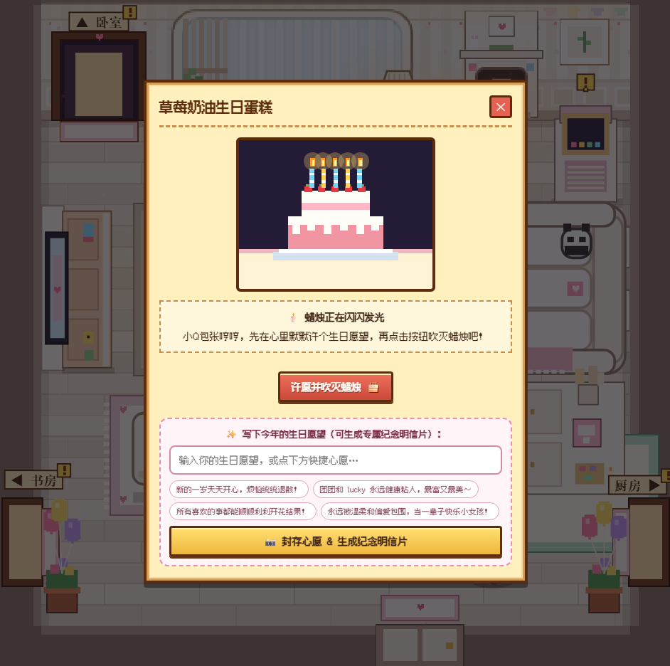
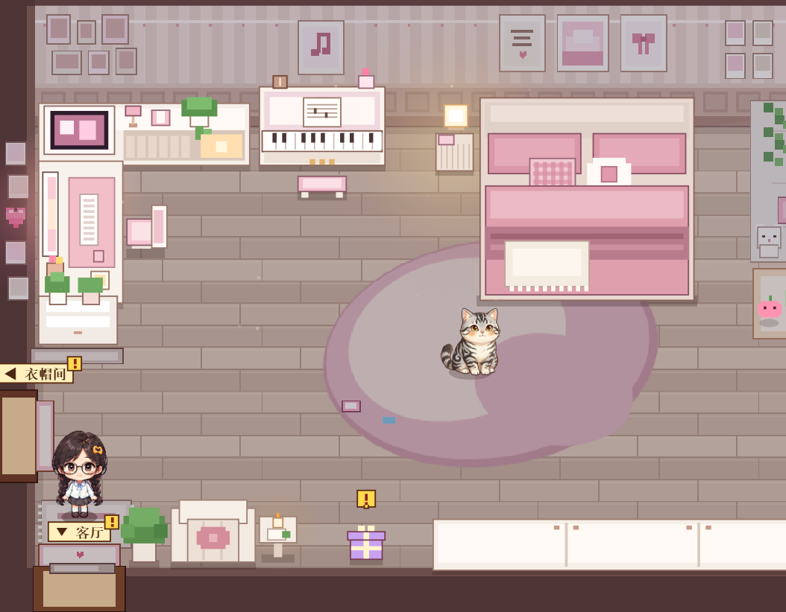
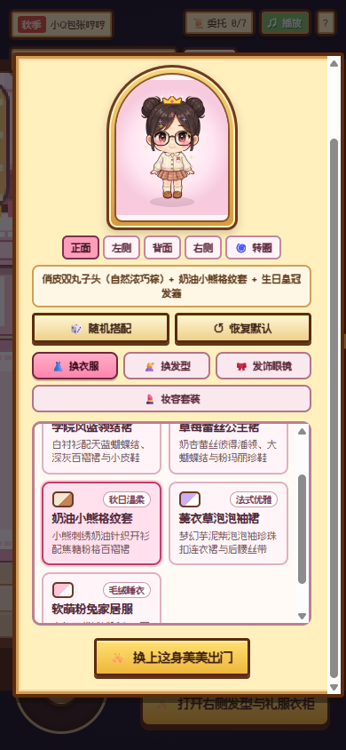
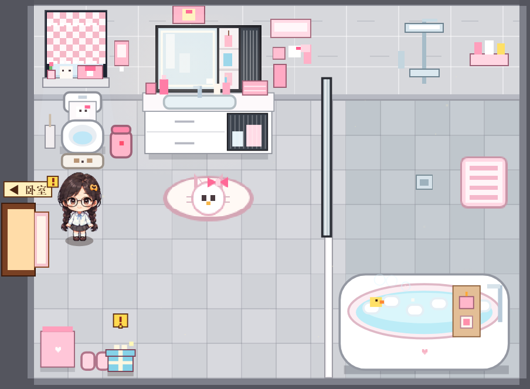

# 🎂 送她一间能走进去的生日小屋

> **生日礼物还能怎么送？**
> 不是一支口红、一个红包，而是**一间她真的可以走进去、逛一整晚的小屋**：
> 六间房，每间房里都藏着一份礼物；拆开礼物盒，弹出来的不是道具，而是**一句只写给她的话**。

星露谷像素风、手机电脑都能玩、双击即开。部署到 **GitHub Pages** 后把链接发过去，TA 点开就能开始过生日。

---

## 🎁 这份礼物的核心：一房一礼

不是把祝福堆成一大段话，而是**让她自己一间间找出来**——找到的每一步都算数。

| 房间 | 礼物藏在哪里 | 拆开是什么 |
| --- | --- | --- |
| 🎂 客厅 | 阳台橄榄树旁 | 🌟 **生日星之果实** · 把一整年的甜蜜和好运气都浓缩进去了 |
| 🛏️ 卧室 | 云朵沙发椅旁 | 🍇 **永远好运上古果** · 工作、学习、生活里的小目标一路开挂 |
| 💄 衣帽间 | 落地全身镜旁 | 🎁 **专属心愿免单券** · 一张「无条件答应的小心愿」，随时兑现 |
| 🛁 浴室 | 粉色脏衣篮旁 | 🍀 **一整年的平安喜乐护身符** · 三餐四季安稳健康 |
| 🍳 厨房 | 果蔬小推车旁 | 🧋 **无限次甜品兑换券** · 奶茶和草莓蛋糕，永远有效 |
| 💌 书房 | 丝带礼物宝箱 | 🚌 **随时出发的旅行约定** · 下一站一起去看更辽阔的风景 |

每个礼物盒都有独立的配色、丝带、图标和「金星 / 铱星 / 限定」稀有度，拆开时的音效、粒子和祝福语都不一样。

---

## 🕯️ 一条完整的生日流程，词都替你想好了

送礼物最怕不知道说什么。这间屋子把整晚串成了一条线：

1. **推门** —— 欢迎页写着 TA 的名字，按下「进入小屋」。
2. **逛屋子** —— 六间房木门互通，也能点左上角「🗺️ 平面图」一键串门。
3. **找礼物** —— 每间房一个礼物盒，找齐 6 份。
4. **许愿吹蜡烛** —— 客厅中央的草莓奶油蛋糕，点蜡烛、默念愿望、写下来还能**生成一张专属生日明信片**。
5. **读信** —— 书房窗前的火漆生日来信，是一整封认真写的长信。
6. **集齐 10 项祝福** —— 满屋烟花 + 星之果实结局，替你说完最后那句「生日快乐」。

> 右上角「📜 委托」随时能看到还剩哪几项没找到，不会漏掉任何一间房。

---

## 💌 真正让人破防的，是这些细节

- **拍立得照片回忆墙**：书房墙上串着 4 张回忆卡片，每张都有标题、日期和一段小文案（黄昏散步、躲雨吃甜品、山坡数星星、草地野餐）。把 `image` 换成你们真实合照，整面墙就是你们的故事。
- **生日来信**：火漆封印的长信，段落可以一段段替换成你自己写的话。
- **朋友祝福电台**：五段不同角色的留言——「最重要的人」「团团」「lucky」「好朋友们的合唱」「祝尼魔小分队」，像一场小型生日派对。
- **暖心小纸条**：7 条安慰语录，累的时候点开就有一句刚好击中。
- **专属语音留言**：可以把自己偷偷录的一段话放进 `assets/audio/voice-wish.mp3`，TA 点开就能听到你的声音。
- **星空夜晚模式**：点一下「🌙 星空夜」，整间屋子换成月亮、星空和暖黄灯光。
- **两只小家伙**：客厅的八哥「团团」会自己散步、打盹、跑来蹭腿；卧室的美短「lucky」会在猫爬架旁呼噜噜。



---

## 🎮 不只是「看一眼」，她能玩一整晚

- **自由换装**：5 套服装 × 5 种发型 × 5 种发色 × 7 种发饰 + 妆容眼镜，正面 / 侧面 / 背面 / 睡觉姿势实时生效。
- **炒菜做饭**：12 种食材、8 道私房菜谱，控火、颠勺、撒调料，做好的菜会端上出餐台冒热气。
- **真的能弹的钢琴**、能打开小游戏的电脑、点唱机、黑胶唱片机、浴缸泡澡、沙发上盖被子睡觉。
- **烟花 & 粒子**：蜡烛、爱心、气泡、热气、音符，集齐委托后全屋放烟花。



---

## ✨ 六间房实景

整套小屋由 **6 间墙壁分隔、木门互通的独立房间** 组成，也可以点「🗺️ 平面图」一键串门。

### 1. 🎂 法式奶油甜心客厅（`living`）
拱形白纱落地窗、粉色毛毛虫椅、悬浮电视墙、奶油云朵沙发（可坐下抱着熊猫看电视）、法式壁炉、复古点唱机、中央生日蛋糕桌。


### 2. 🛏️ 法式奶油少女卧室（`bedroom`）
粉色公主双人床（可盖被子睡觉 `Zzz`）、可真实弹奏的奶油立式钢琴、RGB 透明机箱电脑桌、飘窗祝尼魔与三门大衣柜。


### 3. 💄 甜心化妆衣帽间（`dressing`）
整墙裙柜、带灯泡的化妆镜、落地全身镜与多层透明纸娃娃换装系统。



### 4. 🍳 美乐蒂粉嫩小厨房（`kitchen`）
贴满贴纸的双门冰箱、粉色波点窗洗菜池（洗菜 `+12` 美味度）、双灶台与美乐蒂锅具、电饭煲、出餐台。


### 5. 💌 奶油书房与回忆间（`study`）
法式拱门书架、灯串拍立得照片墙、生日日历、火漆生日来信、水彩画架、樱花粉阅读沙发、黑胶唱片机与丝带礼物宝箱。


### 6. 🛁 草莓泡泡浴室（`bathroom`）
粉色方砖墙、壁挂洗手柜与黑框镜柜、蝴蝶结马桶、格纹浴帘淋浴间、独立式泡泡浴缸（可泡澡发呆）。



---

## 🚀 三分钟把它送出去

项目**零构建、无 npm 依赖**，改完文案直接部署即可。

### 先在本地看一眼
1. 安装 [Node.js](https://nodejs.org/)（16+）。
2. 在项目目录运行：
   ```bash
   node server.mjs
   ```
3. 浏览器打开 `http://127.0.0.1:4173/`。
4. **想用手机看**：终端会打印局域网地址（如 `http://192.168.x.x:4173/`），手机连同一 Wi-Fi 打开即可，自带虚拟摇杆与点触寻路。

> 也可以用 VS Code 的 Live Server 插件右键 `index.html` → `Open with Live Server`。
> ⚠️ 不要直接双击 `index.html`（`file://` 会被浏览器拦截部分资源）。

### 再部署到 GitHub Pages（免费、有网址）
1. 新建仓库或 Fork 本仓库，把文件推到 `main` 分支。
2. 仓库 **Settings → Pages**。
3. **Source** 选 `Deploy from a branch`，分支选 `main`、目录 `/ (root)`，保存。
4. 等 1~2 分钟，页面顶部会出现 `https://你的用户名.github.io/birthday_GAME/`，复制发给寿星即可。

---

## 🎨 换成你们自己的故事

所有文案和素材都拆得很干净，用记事本改就行。

### 1. 名字、日期、来信、礼物、照片墙
全部集中在 **`js/config.js`**：

```js
celebrantName: '小Q包张哼哼',  // 寿星的名字
senderName: '一直惦记你的人',  // 你的署名
birthdayDate: '2026-11-20',   // 生日（YYYY-MM-DD）
```

- **改来信**：`letter.paragraphs` 数组，一段一行。
- **改 6 份礼物**：`gifts` 数组里的 `name`（名字）、`tagline`（副标题）、`message`（拆开后的祝福）、`roomHint`（提示藏在哪）。
- **改照片墙**：
  1. 把照片放进 `assets/memories/`（如 `photo1.jpg`）。
  2. 在 `memories` 里把对应项的 `image: ''` 改成 `'assets/memories/photo1.jpg'`，再改 `title` 和 `caption`。
- **改暖心纸条 / 朋友祝福 / 愿望预设**：`comfortNotes`、`friendsBlessings`、`wishPresets`。
- **改用词与提示**：`quests`（10 项委托的标题与位置提示）与 `finale`（烟花结局的三段话）。

### 2. 换人物与衣服
- 基础小人：`assets/protagonist.png`、`protagonist-side.png`、`protagonist-back.png`、`protagonist-sleep.png`、`protagonist-portrait.png`。
- 换装图层：`assets/wardrobe/`，按 `部位_名称_视角.png` 命名（如 `outfit_strawberry_princess_front.png`），**同名同尺寸透明 PNG 覆盖即可**。

### 3. 换宠物
- 图片：`assets/pets/pug.png`、`shorthair.png`（及 `-portrait.png` 对话头像）。
- 名字 / 房间 / 大小 / 活动范围：改 **`js/pets.js`** 里的 `name`、`roomId`、`scale`、`bounds`；台词在 `config.js` 的 `petDialogues`。

### 4. 换音乐与语音
- 背景音乐：把 mp3 命名为 `birthday-bgm.mp3` 覆盖 `assets/audio/birthday-bgm.mp3`。
- 你的语音留言：录一段命名为 `voice-wish.mp3` 放进 `assets/audio/`，再按需改 `voiceWish.transcript` 的文字稿。

### 5. 想从头再演一遍
右上角「📜 委托」→「重置探索进度」。换装与菜谱进度存在 `localStorage`，清除站点数据即可。

---

## 📁 项目结构

```text
birthday_GAME/
├── index.html          # 主页面与 HUD / 菜单弹窗结构
├── server.mjs          # 零依赖 Node.js 本地静态服务器
├── css/style.css       # 双端自适应布局、星露谷木框 UI
├── js/
│   ├── config.js       # ⭐ 名字、来信、礼物、照片墙、祝福、委托总配置
│   ├── room-map.js     # 六室尺寸、碰撞网格、门洞与可交互物体坐标
│   ├── room-art.js     # 六室像素家具、光影、礼物盒与动态细节
│   ├── wardrobe.js     # 多层透明纸娃娃换装与染发引擎
│   ├── cooking.js      # 12 种食材与 8 道菜谱
│   ├── pets.js         # 团团 & lucky 的巡逻、打盹与互动状态机
│   ├── particles.js    # 烟花、蜡烛、爱心、气泡、热气、音符
│   ├── audio.js        # WebAudio 合成音效、钢琴音源与 BGM
│   ├── ui.js           # 弹窗、对话、生日菜单、钢琴/电脑/换装/炒菜交互
│   └── game.js         # 主循环、键盘/摇杆/点触寻路与三视图渲染
├── docs/screenshots/   # README 展示截图
└── assets/             # 角色、衣帽间图层、宠物、图标、UI 与音频
```

---

**比起红包，她更会记住这间为她亮着灯的小屋。**
祝你们生日快乐、岁岁欢喜 🎉🎂✨
